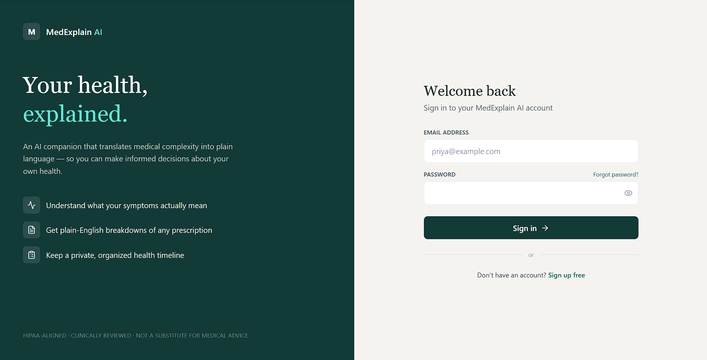
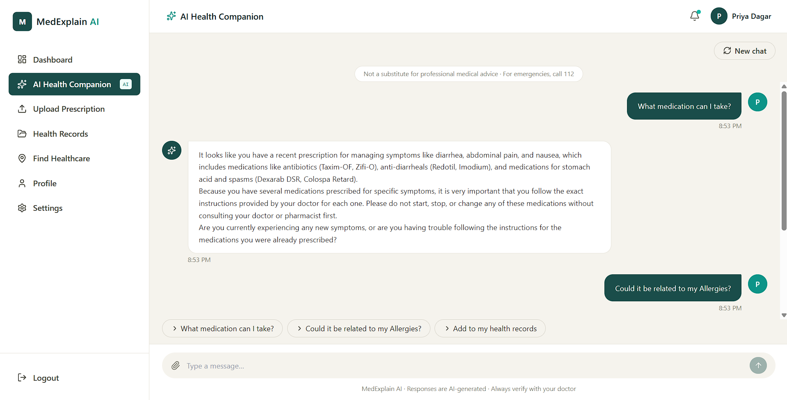
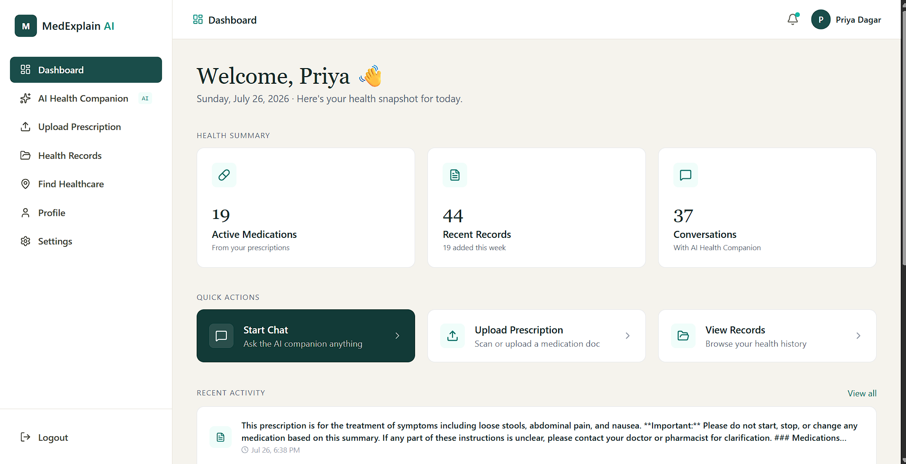
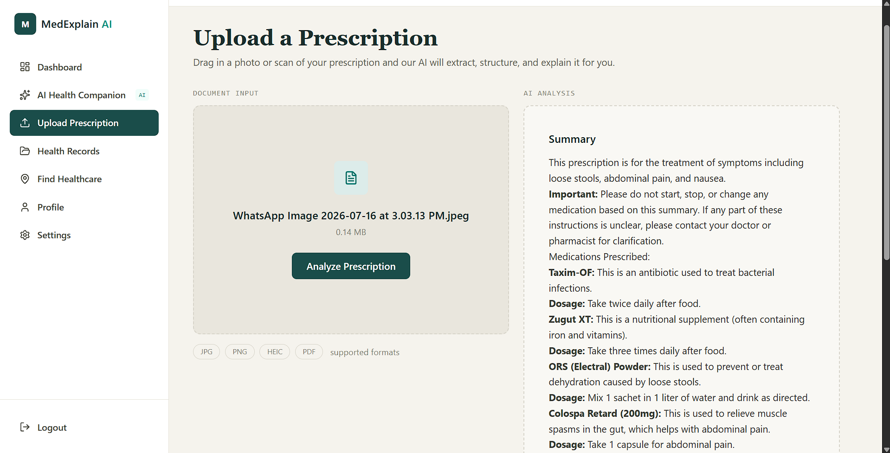
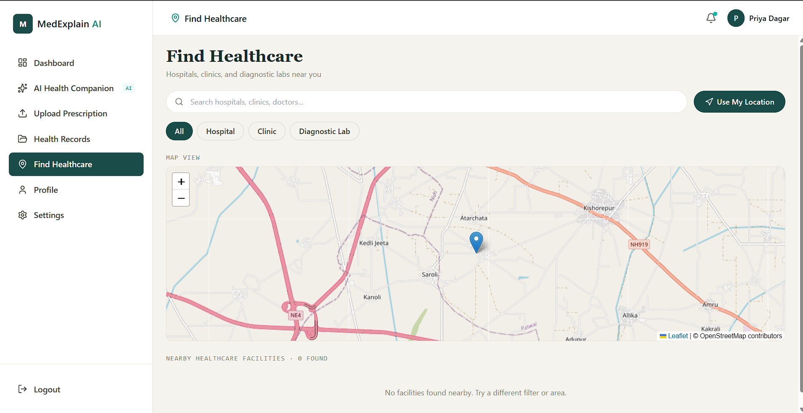

# MedExplain AI

An AI-powered assistant that helps people understand their prescriptions, chat about their health in plain language, keep a personal health record, and find nearby healthcare — all in one platform.

🔗 **Live App:** [MedExplain](https://priyadagar.site/)

---

## 📸 Screenshots

| Login | AI Chat | Health Record Dashboard |
|---|---|---|
|  |  |  |

| Upload Prescription | Find Healthcare |
|---|---|
|  |  |


---

## 🩺 What It Does

MedExplain AI solves a simple problem: medical information is confusing. The app lets a user:

- **Upload a prescription photo** and get it explained in plain language (via Vision AI)
- **Chat with an AI assistant** about symptoms, medicines, or general health questions
- **Maintain a health record** — all prescriptions and profile info in one searchable place
- **Find nearby healthcare** — clinics, pharmacies, and hospitals on an interactive map

Behind the scenes, a **multi-agent AI system** (built with LangGraph) routes each request to the specialist agent best suited to handle it, instead of relying on one generic prompt for everything.

---

## 🧱 Tech Stack

| Layer | Technology |
|---|---|
| Frontend | React, TypeScript, Tailwind CSS, Vite |
| Backend | FastAPI, SQLAlchemy, Alembic, JWT Auth |
| AI Orchestration | LangGraph, LangChain (Supervisor + 3 specialist agents) |
| LLM / Vision | Google Gemini |
| Database | PostgreSQL (Supabase) |
| File Storage | AWS S3 |
| Email / OTP | AWS SES |
| Maps | OpenStreetMap, Overpass API, Leaflet |
| Deployment | AWS EC2 (backend, via NGINX + SSL), Vercel (frontend) |

---

## 🏗️ System Architecture

```
React Frontend (Vercel)
        │
FastAPI Backend (AWS EC2) — JWT Auth
        │
LangGraph Supervisor
   ├── Symptom Agent
   ├── Health Record Agent   ──► Gemini (LLM + Vision)
   └── General Agent
        │
PostgreSQL (Supabase) · AWS S3 · AWS SES · OpenStreetMap/Overpass
```

---

## 🚀 Getting Started (Run Locally)

### Prerequisites
- Node.js 18+
- Python 3.13
- PostgreSQL (or a Supabase project)
- API keys: Gemini, AWS (S3 + SES)

### 1. Clone the repo
```bash
git clone https://github.com/priya-dagar/MedExplain-AI.git
cd medexplain-ai
```

### 2. Backend setup
```bash
cd backend
python -m venv venv
source venv/bin/activate      # Windows: venv\Scripts\activate
pip install -r requirements.txt

cp .env.example .env          # fill in your keys, see below
alembic upgrade head          # run DB migrations
uvicorn main:app --reload     # http://localhost:8000
```

### 3. Frontend setup
```bash
cd frontend
npm install
cp .env.example .env          # set VITE_API_URL to your backend URL
npm run dev                   # http://localhost:5173
```

### Environment Variables

**Backend (`.env`)**
```
DATABASE_URL=
JWT_SECRET_KEY=
GEMINI_API_KEY=
AWS_ACCESS_KEY_ID=
AWS_SECRET_ACCESS_KEY=
AWS_S3_BUCKET=
AWS_SES_SENDER_EMAIL=
```

**Frontend (`.env`)**
```
VITE_API_URL=http://localhost:8000
```

---

## 📁 Project Structure

```
medexplain-ai/
├── backend/
│   ├── app/
│   │   ├── agents/        # LangGraph agents (Supervisor, Symptom, Health Record, General)
│   │   ├── models/        # SQLAlchemy models
│   │   ├── routes/        # FastAPI routes
│   │   └── main.py
│   └── alembic/           # DB migrations
├── frontend/
│   ├── src/
│   │   ├── pages/
│   │   ├── components/
│   │   └── api/
│   └── vite.config.ts
└── README.md
```

---

## 🗺️ Roadmap

- [ ] RAG with ChromaDB for grounded, source-backed answers
- [ ] Lab Results & Visit history record types
- [ ] Conversation memory for the Health Record Agent
- [ ] Rate limiting on API endpoints
- [ ] Custom domain + SSL, tighter CORS/security hardening

---

## 👤 Author

**Priya Dagar** — B.Tech CSE (AI & ML)
· [LinkedIn](#) · [YouTube](#)

---

## 📄 License

MIT — free to use and modify.
